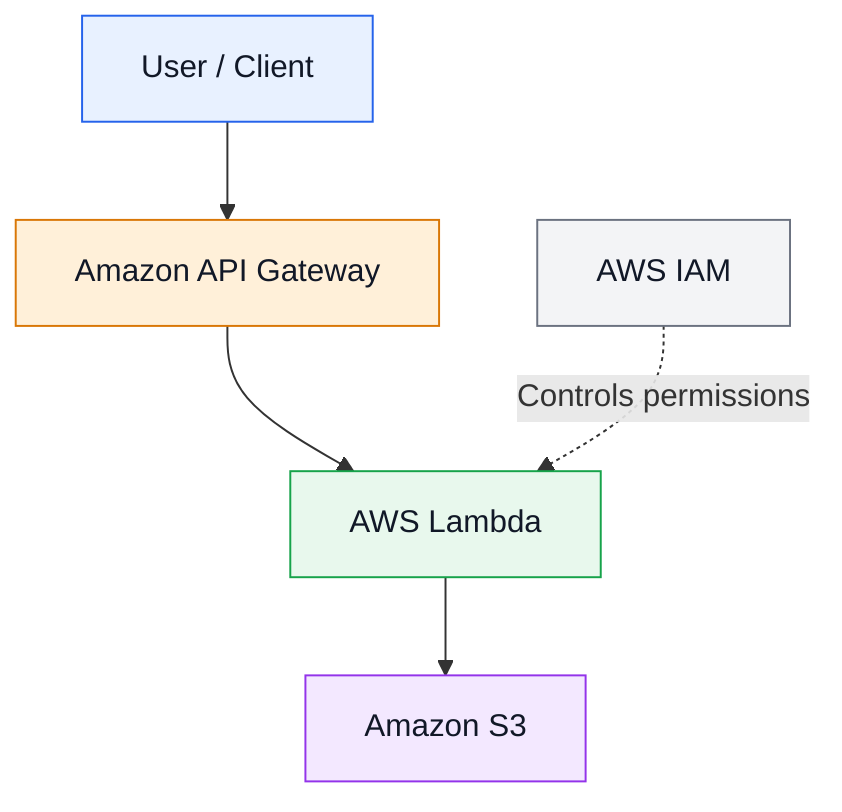

# Serverless Web Application on AWS

A cloud-native serverless web application built using AWS services to provide scalable API handling, object storage, and secure access without managing traditional servers.

## Overview

This project demonstrates how AWS serverless services work together to build an application with reduced infrastructure management. It uses managed AWS services to handle API requests, execute backend logic, store objects, and control access permissions.

## Architecture

### Request Flow

1. The user sends a request to Amazon API Gateway.
2. API Gateway routes the request to the configured AWS Lambda function.
3. Lambda executes the backend application logic.
4. Lambda accesses Amazon S3 when required and permitted.
5. AWS IAM roles and policies control access to AWS resources.
6. The response is returned to the client through the configured API integration.

> Note: Verify that the architecture and request flow match your actual implementation before publishing.

## AWS Services Used

| Service | Purpose |
|---|---|
| AWS Lambda | Executes backend code on demand without managing servers. |
| Amazon API Gateway | Creates and manages API endpoints and routes requests. |
| Amazon S3 | Stores objects, application files, and static assets as required. |
| AWS IAM | Manages identities, roles, policies, and resource permissions. |

## Key Features

- Serverless backend processing.
- API endpoints managed through Amazon API Gateway.
- Object storage using Amazon S3.
- IAM-based access control.
- Reduced server maintenance.
- Scalable architecture using managed AWS services.
- Flexible foundation for future automation and monitoring.

## Deployment Steps

The following is a general deployment outline. Actual steps depend on the application's code and configuration.

1. **Create an S3 bucket**
   - Create a bucket for the required application assets or objects.
   - Configure appropriate access permissions.

2. **Configure AWS Lambda**
   - Create a Lambda function with the required runtime.
   - Upload the application code and configure the handler.
   - Set the required environment variables.

3. **Configure AWS IAM**
   - Create or assign an execution role to Lambda.
   - Grant only the permissions required by the function.

4. **Configure Amazon API Gateway**
   - Create the required API and routes.
   - Integrate the routes with the Lambda function.
   - Configure authorization and request validation where required.

5. **Deploy the API**
   - Deploy the configured API to the appropriate stage.
   - Obtain the API endpoint.

6. **Test the application**
   - Send test requests to the API endpoint.
   - Verify the expected responses and S3 operations.
   - Review application logs in Amazon CloudWatch.

## Security Considerations

- Follow the principle of least privilege for IAM roles and policies.
- Never commit AWS access keys, passwords, or other secrets to GitHub.
- Restrict S3 bucket access according to the application's requirements.
- Validate incoming API requests and handle errors safely.
- Store sensitive configuration in appropriate secret-management services.
- Monitor application logs and investigate unexpected activity.

## Monitoring and Troubleshooting

- Use Amazon CloudWatch logs to investigate Lambda execution issues.
- Review Lambda metrics for invocation counts, errors, and duration.
- Check API Gateway configuration and integration responses when requests fail.
- Verify IAM permissions when AWS resource access is denied.
- Confirm S3 bucket names, object permissions, and configured resource identifiers.

## Learning Outcomes

Through this project, the following concepts can be explored:

- AWS serverless architecture.
- Event-driven backend processing using Lambda.
- API creation and request routing with API Gateway.
- Object storage using Amazon S3.
- Identity and access management with IAM.
- Cloud security and least-privilege permissions.
- Application monitoring and troubleshooting.
- Scalable cloud application design.

## Future Improvements

- Automate infrastructure provisioning using Terraform or AWS SAM.
- Implement a CI/CD pipeline for automated deployments.
- Add automated tests for backend functions and API endpoints.
- Configure CloudWatch alarms and dashboards.
- Improve API authentication, authorization, and request validation.
- Add structured logging and centralized monitoring.
- Document API request and response examples.

## Author

**Varun Pandya**

- LinkedIn: [Visit My LinkedIn Profile](YOUR_LINKEDIN_PROFILE_URL)

---

If you find this project useful, feel free to explore the repository and learn more about AWS serverless architecture.

**Technologies:** AWS Lambda | Amazon API Gateway | Amazon S3 | AWS IAM
